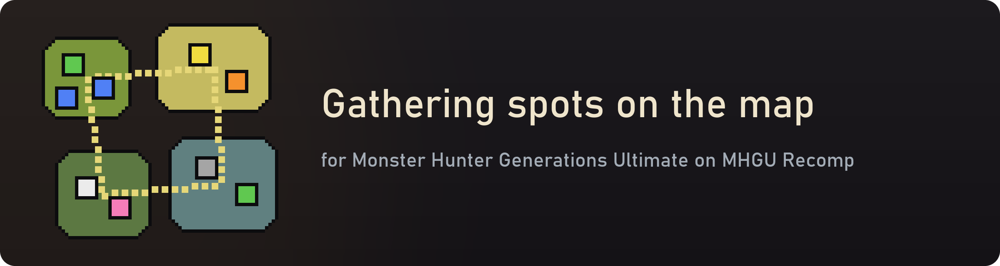

  

  <a href="https://github.com/lick-mee/mhgu-gathering-map/releases/latest"><b>Download the latest release</b></a>

A map mod for [MHGU Recomp](https://github.com/morerokk/MHGURecomp), the PC port of Monster Hunter Generations Ultimate.

The quest map shows monsters, hunters and traps, but not where to gather. Gathering Map adds every gathering spot to the map, with the icon and color of the item it mostly gives: mining spots as ore, bone piles as bones, bug spots as bugs, plus herbs, mushrooms, honey, berries, webs, eggs, dung, whetstones, bait and wood. Icons sit under the game's own markers and only show for the areas the map is showing.

## Install

1. Download `gather-map-v1.1.0.zip` from [Releases](https://github.com/lick-mee/mhgu-gathering-map/releases).
2. Extract the `zzz-gather-map` folder into the `mods` folder of [MHGU Recomp](https://github.com/morerokk/MHGURecomp).
3. Start the game.

There's nothing to run: it's a plugin the recomp loads by itself (`log.txt` shows `gather-map: gathering points on the map`), and it doesn't replace any game files. To uninstall, delete the `zzz-gather-map` folder. Coming from v1.0.0? Delete the old `zzz-gather-map` folder first; `setup.bat` isn't needed any more.

## Options

Press **Insert** in game and open **Gathering Map**:

- **Show gathering points on the map**: the mod itself.
- **Also show other pickups**: off by default. Crates, barrels and arena ammo spots, with the game's `!` dropped-item marker.
- **Icon size (%)**: 35 by default.

Options reset at each start.

## Compatibility

- Tested on MHGU Recomp 0.9.7, which runs the game at version 1.4.0, with the game in English.
- Doesn't replace any game files, so it works alongside UI and texture mods ([Pixel Pack v4](https://www.reddit.com/r/MonsterHunter/comments/1icfs4z/mhgu_hd_texture_mod_60_fps_and_multiplayer_2025/)'s HD UI, [HD Hunter Font](https://github.com/lick-mee/mhgu-hd-hunter-font), [Confirm on X](https://github.com/lick-mee/mhgu-confirm-on-x), …), using their icons.
- Spots show where they can be. Whether one is up on this particular quest, or already gathered, isn't tracked.
- Recomp only: it's a Forge plugin that hooks the recomp's game code. Emulators aren't supported.

## How it works

Each map has a set of gathering points per area (world position, kind of spot) and item lots per rank; a point's icon comes from the items its lot gives most, using the icons and colors of the game's own item table. `tools/make_data.py` turns them into `src/points.h`.

The quest map draws its icons through one icon object per map view. Each keeps a GUI instance of the `map_icon` layout per icon and every frame converts a world position to the map and shows or hides it. The plugin hooks that object: when it initializes, the plugin makes extra instances of its own, and after each of its updates places them on the gathering points of the current map, pointing each one's texture object at the item icon (the common icon texture, the icon's cut, the item color). `src/plugin.c` has the game addresses and offsets.

## Thanks

[MHGU Recomp](https://github.com/morerokk/MHGURecomp), which this mod is made for, and [mhw-gui-editor](https://github.com/Fexty12573/mhw-gui-editor), whose GUI file layout helped find the way.

## License

MIT for the code. Monster Hunter Generations Ultimate © CAPCOM.
